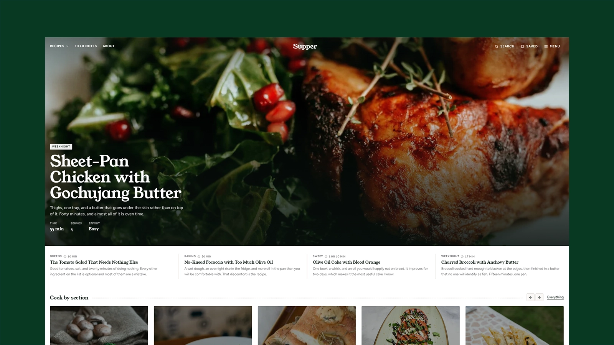

# Supper - Astro Recipe & Food Blog Theme

[](https://supper.xocoweb.workers.dev/)

[](https://astro.build/)
[](https://tailwindcss.com/)
[](https://www.typescriptlang.org/)
[](./LICENSE)

**Live preview:** https://supper.xocoweb.workers.dev/

Supper is a premium Astro theme for a food blog run by one cook. A post becomes a recipe by adding a `recipe` block to its frontmatter, and from that one block the theme prints a servings stepper that scales the shopping list, tickable ingredients and steps, cook times on every card, a print sheet, and schema.org `Recipe` data. The front page is dealt from the archive rather than filled by hand, so a site with six recipes and one with six hundred both look deliberate. The output is static, full-width, near-square, and one colour mode.

## Features

- An optional `recipe` block in frontmatter — servings, yield, prep, cook and resting time, difficulty, grouped ingredients, a numbered method, cook's notes, what it keeps like, and the equipment it will not work without — refused in the reading section so an essay can never grow an ingredient list
- Ingredient amounts stored as `quantity` + `unit` + `item`, so the servings stepper scales them exactly and prints kitchen fractions (`¾`, `1½`) rather than decimals, with a `fixed` flag for tin sizes and pinches and a `plural` for countable things
- A metric and imperial switch beside the servings stepper, converting the shopping list, the oven temperatures, and the measurements written into the method, the cook's notes and the article prose — amounts landing on fractions a kitchen owns, ovens on the marks the dial has, and the choice remembered per browser
- Tickable ingredients and steps with no JavaScript, in one accent colour that only ever means "done"
- Cook time on every surface a recipe reaches — hero, cards, archive entries, ranked list, search, article header — and no read-time estimate anywhere
- A print sheet for recipes, reached from a Print control beside Share and Save: chrome removed, the picture sized to the paper, ingredients and method kept whole across page breaks, amounts printed at whatever scale the reader set
- A front page dealt from the archive with no repeats: an edge-to-edge featured recipe chosen in frontmatter, running under a transparent header, with its brief set over the photograph and the next four as a row of type, a scrolling section rail, a dense grid of covers, a rail of recipes done in half an hour derived from their own cook times, the writing as dark cards, a row of round plates, a tinted band over the ones cooked on repeat, and a ranked chart beside the sweet section — every block hiding itself when it has nothing to show, and the picture grids dropping their last part-filled row rather than leaving cards hanging
- A masthead of three links — Recipes opening a full-width panel of every section on the cover of its newest recipe — a centred wordmark, and Search, Saved, and Menu, with a focus-trapped drawer laid out as a contents page: every section with its blurb and count, plus an opening-layout menu derived from the posts
- Four article openings set per post — `standard`, `banner`, `cover`, `immersive` — sharing one title block
- Archive, section, tag, and author pages built from one entry — section, cook time, headline, standfirst, cover — as a four-across card grid or an image-led list, set per section
- A Filters button on the archive and section pages opening a dialog of three dropdowns — section, time, effort — that work across the whole archive from the search index, with the state kept in the URL
- Client-side search with a keyboard palette (`/` or `⌘K`) and a results page, both reading one build-time index that covers ingredients as well as titles, ranked in tiers and matched on word starts
- Saved recipes: a per-browser reading list from any article, read back at `/saved/`, with no accounts or backend
- A feed for everything, one per section, and one per author, carrying full content — a recipe's item opens with its yield, times, and ingredient list
- Markdown content collections with a validated frontmatter schema, drafts excluded from every listing, feed, and index
- Sections, navigation, the recipe scale, the cook's byline, and SEO defaults in four config files, so the site can be renamed and re-scoped without touching a component
- Provider-neutral newsletter and contact forms — point them at any endpoint that accepts a POST, or leave them off
- Per-post share cards cropped from each cover at build time, plus canonical URLs, sitemap, RSS, `robots.txt`, Open Graph, Twitter/X cards, and JSON-LD for `Recipe`, `Article`, `BreadcrumbList`, and `WebSite`
- Two self-hosted typefaces (Young Serif, Figtree), a white page with a spinach-green accent, one colour mode, and a radius scale that sits at a few pixels and can be set to `0` in one place
- Static output with no framework islands; JavaScript only for search, the drawer, the filters, the servings stepper, the units switch, and the progress bar
- CSS-only scroll-driven motion with a fallback, flattened under `prefers-reduced-motion`
- Skip link, landmarks, labelled controls, visible focus states, and one tab stop per archive entry

## Tech Stack

- Astro 7 with MDX
- Tailwind CSS 4 via the Vite plugin
- Vite 8, TypeScript, Astro content collections
- `@astrojs/sitemap`, `@astrojs/rss`, Sharp
- Self-hosted Young Serif and Figtree fonts, and a local Bootstrap Icons set with its license notice

## Requirements

- Node.js `22.12.0` or newer
- npm

## Getting Started

```bash
npm install
npm run dev
```

Build for production:

```bash
npm run build
```

Preview the production build locally:

```bash
npm run preview
```

Before shipping a change, run type checking, the production build, and the formatter check together:

```bash
npm run release:check
```

## Customization

See [CUSTOMIZATION.md](./CUSTOMIZATION.md) for site settings, sections, the recipe system and its frontmatter, the front page blocks, the header and menu, archive filters, images, search, feeds, forms, the print sheet, motion, and the theme's design tokens.

Set `siteConfig.siteUrl` in [src/config/site.ts](./src/config/site.ts) before building — canonical URLs, share images, the sitemap, and the feeds are all derived from it. The build is static, so any host that serves a directory works: `wrangler.jsonc` is included for Cloudflare Workers, and Netlify, Vercel, GitHub Pages, and object storage behind a CDN need no configuration beyond `npm run build`.

## Content

Posts live in [src/content/posts](./src/content/posts). Each post is a folder with an `index.md` and a `cover.jpg` beside it, validated by the schema in [src/content.config.ts](./src/content.config.ts). A recipe is an ordinary post with a `recipe` block added; see [Recipes](./CUSTOMIZATION.md#recipes) for the field list.

The bundled demo content is fictional and the byline is invented — **replace it before launch.** Demo photography comes from [Unsplash](https://unsplash.com/) under the [Unsplash License](https://unsplash.com/license), and every cover carries its photographer and source URL in frontmatter. The author portrait is an Unsplash placeholder of a model with no connection to the fictional byline.

## Support

See [SUPPORT.md](./SUPPORT.md) for what a license includes, and [CHANGELOG.md](./CHANGELOG.md) for release history.

## License

Commercial license. See [LICENSE](./LICENSE) for complete terms.
